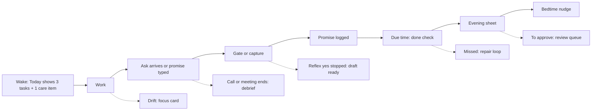
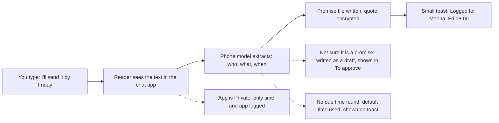
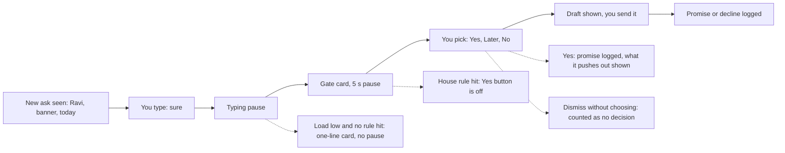
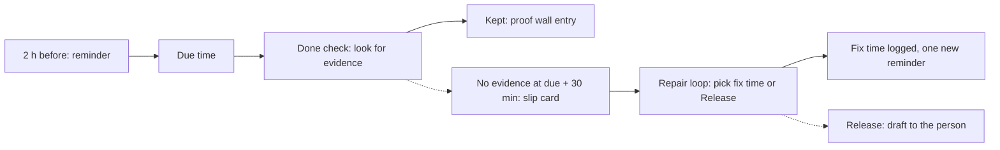
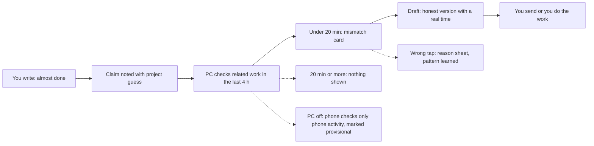
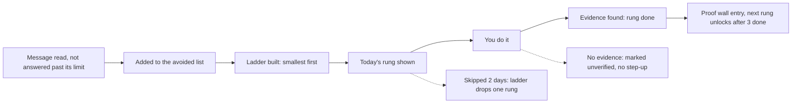
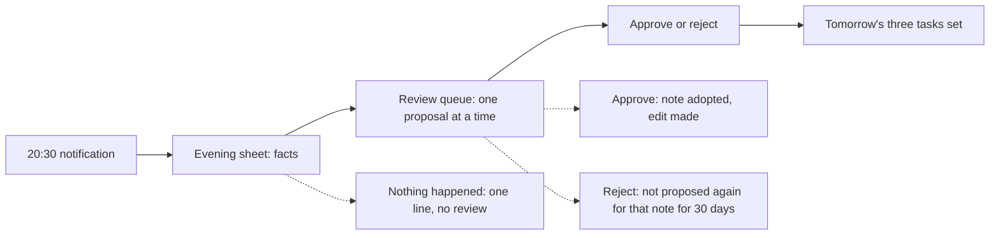
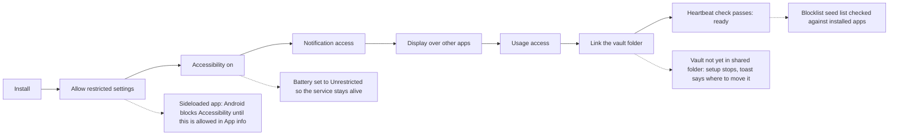
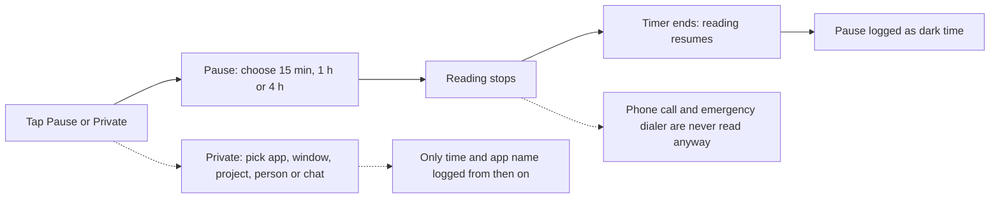

# 05. User flows

Owner role: interaction designer. Inputs: 03, 04.

Rules for every flow here: one straight main line, branches hang off it, no screen without a connection, nothing loops back on itself for a single link. Retry and error moments are a toast (the existing Snackbar style from Private Folder, restyled with Nayom tokens).

---

## F1. A normal day (the main line)

Real example: Surya wakes, sees Meena's file due 17:00. Ravi asks for a banner tweak. The gate stops a reflex yes. The file goes out at 16:50 and is marked kept. At 20:30 he sees the day's facts and approves one note edit.

---

## F2. Capture a promise (typed)

Real example: Surya types "I'll send the final by Friday" to Meena. A toast shows "Logged for Meena, Friday 18:00". If Friday 18:00 is wrong, he taps the toast and changes it.

---

## F3. The yes-gate

Gate card content, top to bottom: the ask in your own words (person, task, due), "Open and due in 48 hours: 3", the item it would push out, then three buttons.

Real example: "Meena's file is due today 17:00. Saying yes puts it at risk." He taps "Later". The draft reads: "Can do Friday morning, not today."

---

## F4. A promise comes due

Real example: the file for Meena has no export and no message by 17:30. Slip card: "File for Meena was due 17:00. Not sent." Surya picks "Fix by 18:30". Nayom reminds once at 18:00. If missed again, the second slip counts toward escalation (08).

---

## F5. Claim versus activity

Real example: "Almost done with the banner" with zero minutes in the design tool today. Card: "You told Ravi almost done. No work on it today." Draft: "I haven't started it. I can have it Friday 11:00."

---

## F6. Avoidance to stretch ladder

Real example: a vendor's call has gone unanswered for 3 days. Rung 1: read the message again. Rung 2: type a reply and keep it. Rung 3: send it. Rung 4: call.

---

## F7. Evening sheet and review

---

## F8. First run and setup

---

## F9. Private and Pause

---

## Retry and error moments

| Moment | What you see |
| --- | --- |
| Vault write failed | Toast: "Couldn't save. Trying again." Full-width icon-only button shows a loader, then returns to its start state |
| Sync behind | Small line on Today: "Phone is 1 h behind the PC" |
| Model slow | Card appears with facts only; the draft arrives a moment later |
| Reader stopped | Persistent notification turns berry: "Reading is off" with a Turn on button |
