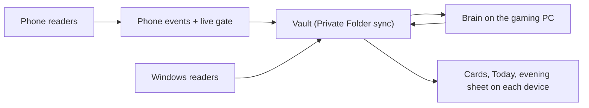

# 12. Architecture and sync

Owner role: solution architect. Inputs: 03, 08, 09, 10, 11, decision D-17.

## Parts

| Part | Where | Built with | Job |
| --- | --- | --- | --- |
| Nayom Phone | S24 Ultra | Kotlin, Jetpack Compose | Readers, live gate, cards, all screens |
| Nayom Windows | Gaming PC and laptop | Dart | Readers, tray window, cards |
| Browser extension | Chrome or Edge on both PCs | JavaScript | Tab title and address, with the blocklist |
| Nayom Brain | Gaming PC | Dart service plus a local model server | Judging, verdicts, day files, proposals |
| Vault | Inside the Private Folder shared folder | Markdown | The only database |
| Private Folder | All three devices | Existing app (Dart and Flutter) | Copies the vault between devices on your network |



## Rule: files are the only interface

The phone, laptop and PC never call each other. They write files and read files. Private Folder moves the files. This keeps every part replaceable and means nothing needs network permission.

## Phone detail

| Component | Android feature |
| --- | --- |
| Screen text and typing | Accessibility service |
| Incoming messages | Notification listener |
| App in front, time in app | Usage stats |
| Full-screen cards | Overlay window |
| Reminders | Alarm manager with exact alarms, falling back to WorkManager |
| Vault access | Storage Access Framework grant to the Private Folder documents provider |
| Debrief speech to text | On-device recogniser, audio dropped on completion |
| Phone model | On-device model runner chosen in Phase 0 by benchmark on the S24 Ultra |

Efficiency rules:
- Blocked and Private packages are checked before any screen tree is read.
- Screen events are throttled to one per 500 ms.
- The phone model runs only when a rule cannot decide, and only on text that passed the filter.
- Target battery cost is under 5% a day. This is a target to measure in Phase 1, not a promise.

Samsung settings Nayom needs (setup screen, F8): restricted settings allowed, battery set to Unrestricted, "put unused apps to sleep" off for Nayom and Private Folder, autostart allowed.

## Windows detail

- Readers: active window title and process through the system API; text through UI Automation; idle time and lock state; file saved and exported through a folder watcher on your work folders.
- Apps that expose no text (design canvases, for example) fall back to a screenshot read by OCR, for that app only, and the image is dropped at once.
- The tray window shows Today and Promises, and opens the menu.
- Install: per-user installer, starts at sign-in, no administrator prompt, like Private Folder. Outbound firewall block applied by a script you run once.

## Brain detail

- A local server runs the 7–8B model on the 4060 Ti. It listens on 127.0.0.1.
- The Brain watches the vault for new `events/*`, groups them, applies the rules from 10, and calls the model only for language work.
- It writes `verdicts/`, `slips/`, `days/`, `proof/` and `proposals/`.
- When the PC is off, verdicts are late. The phone keeps working with its own rules, marks slips `provisional`, and the Brain replaces them later with the same ID.

## Latency budget

| Step | Budget |
| --- | --- |
| Typing pause to gate card | 1 s |
| Event written to vault | 2 s |
| Sync phone to PC on the same network | A few seconds, not controlled by Nayom |
| Brain verdict | 60 s from arrival |
| Verdict shown on the phone | Next sync |

## Sync behaviour

- Private Folder syncs on change and keeps both copies on a conflict. The one-writer rule in 09 avoids almost all conflicts.
- Dependencies from 03: DEP-1 LAN-only, DEP-2 background sync that survives Android limits, DEP-3 Nayom folder access, DEP-4 vault move.
- If sync is behind, Today shows "Phone is [n] min behind the PC".

## Failure modes

| Failure | Result |
| --- | --- |
| PC off | Late verdicts, provisional flags, no loss |
| Phone reader killed | Dark time logged; berry status notification |
| Sync stopped | Today shows the delay; phone keeps writing; catches up later |
| Model crash | Rules still run; cards use templates from 13 |
| Vault file malformed | File skipped, a line added to `health.md`, a toast on next open |
| Key lost | Quotes unreadable; everything else works |

## Repository layout (build phase)

One repo, `nayom`:

```
spec/        these files
android/     Nayom Phone
windows/     Nayom Windows
brain/       Nayom Brain
extension/   browser extension
tools/       setup scripts, blocklist checker, test data generators
```

Changes: none yet.
